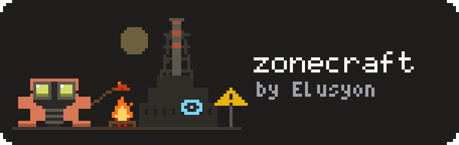

<p align="center">
  
</p>

# zonecraft

A Claude Code plugin for making your own **S.T.A.L.K.E.R. 2: Heart of Chornobyl** mods by talking to Claude, even if
you have never modded anything, used a terminal or written code.

It gives Claude:

- **Rules** for working with you: what to check before building anything, what never to do.
- **Hard-won knowledge** from shipping real mods: how the game and GSC's official mod editor (the *Zone Kit*)
  behave, which approaches crash the game, how to stay compatible with other popular mods.
- **Tools** that set up your PC, write Blueprint logic you paste into the editor (and check it arrived intact), build
  your mod, install it into the game for testing and package it for Nexus Mods.

## Install

In a Claude Code terminal session, type:

```
/plugin install zonecraft --marketplace Elusyon117/zonecraft
```

Answer `y` to add the marketplace, then pick the user scope so it loads in every session. From a shell instead:

```bash
claude plugin install zonecraft --marketplace Elusyon117/zonecraft
```

**Desktop app:** click **+** next to the prompt box → **Plugins** → **Add marketplace** → `Elusyon117/zonecraft` →
**Add plugin**.

Update later with `claude plugin marketplace update elusyon-zonecraft`, then `claude plugin update zonecraft`.

The plugin adds the `zonecraft` skill: Claude uses it by itself whenever you talk about Stalker 2 modding, or you can
type `/zonecraft`.

## How it works

| You | Claude |
|---|---|
| Say what the mod should do | Researches how the game does it and writes a plan |
| Play the game and say what you see ("it worked", "nothing happened", "it crashed when I sat down") | Reads the game's logs and crash reports itself |
| Click or paste in the Zone Kit editor when asked (it tells you exactly where; pasting is Ctrl+V) | Writes the logic, builds the mod, installs it into your game |
| Say when to publish | Packages the release and writes the notes |

After setup you never type commands. You talk in plain language.

## Get started

You need a **Windows PC with the game installed**, about **600 GB of free disk space** for the Zone Kit, and
**Claude Code** with zonecraft installed.

1. **Install the Zone Kit** (the one thing Claude can't do for you): open the **Epic Games Store**, search for
   **S.T.A.L.K.E.R. 2 Zone Kit**, install it, start it once and let it finish its first start (it takes a long time).
   You can do step 2 while it downloads.
2. **Open Claude Code** and send it this:

   > Set me up to make S.T.A.L.K.E.R. 2 mods with zonecraft.

That's it. Claude picks a folder for your mods with you, installs what's missing, finds your game and the Zone Kit,
and asks you a few questions (your name, your GitHub account; it helps you make one if you have none). Twice it will
ask you to do something yourself: approve a GitHub login in your browser, and close and reopen the Zone Kit editor.

## Make a mod

Tell Claude what you want, in your own words:

> I want a mod that makes the flashlight brighter and wider.

It suggests a name, creates the mod (its own folder and GitHub page), researches the game and writes a plan in
`PLAN.md`. Read the plan, say what you think, then say *"go ahead"*. From then on, each round goes like this:

1. Sometimes Claude asks you to do something in the Zone Kit editor: open something and take a screenshot, or paste
   text it prepared (click into the window it names, press **Ctrl+V**, then **Compile** and **Save**). Tell it when
   you're done.
2. It builds the mod (about 5-6 minutes) and installs a test copy into your game. Keep the game closed until it says
   it's installed.
3. It tells you what to do in the game and what should happen.
4. You play and tell it what you saw.

One change per round, so when something breaks you always know what caused it. When something works the way you
want, say *"that works, save a checkpoint"*.

Next time, open Claude Code in the mod's folder and ask *"where were we?"*.

## Handy things to say

| Say | What happens |
|---|---|
| *"Where were we?"* | It reads the mod's notes and tells you the current state and next step |
| *"Save a checkpoint"* | It saves the current working state so it can always return to it |
| *"Roll back to the last checkpoint"* | Undo everything since the last good state |
| *"Remove the test copy"* | Takes your test build out of the game so you can play normally |
| *"Check my setup"* | Runs the setup check and fixes what it can |
| *"Cut a release, version 1.0.0"* | Final build, notes, a zip in your Downloads folder ready for Nexus Mods, test copy removed |
| *"Share what we learned"* | Adds the lesson to zonecraft so every mod gets it |
| *"Update zonecraft"* | Installs the latest zonecraft |

## Publishing on Nexus Mods

After *"cut a release"*: on [nexusmods.com](https://www.nexusmods.com) (free account), open the S.T.A.L.K.E.R. 2
section, choose to upload a mod, fill in the page (name, description, screenshots) and upload the zip from your
Downloads folder. Paste the release notes Claude wrote into the changelog. Tell Claude the mod's Nexus ID so it can
record it.

## Words you will see

| Word | Meaning |
|---|---|
| **Zone Kit** | GSC's official mod editor for S.T.A.L.K.E.R. 2 (a version of Unreal Engine 5.5). |
| **Blueprint** | Unreal's visual scripting: boxes connected by wires. Claude writes them as text you paste. |
| **Asset** | A game file inside the editor: a Blueprint, an animation, an input setting. |
| **Override** | Replacing one of the game's own assets with an edited copy. Two mods can't both override the same asset, so Claude avoids it. |
| **Cook / build** | Turning the editor's files into the compact files the game loads (5-6 minutes). |
| **Pak** | The finished mod files (`.pak`, `.ucas`, `.utoc`) that go into the game's `~mods` folder. |
| **cfg patch** | A small text file that changes single game values (damage, speeds) without replacing whole files. |
| **Checkpoint** | A saved, known-good state of your mod. |
| **Repository / GitHub** | Where each mod's files and history are stored online. |
| **MCM** | Mod Configuration Menu, a popular mod that adds an in-game settings screen for other mods. |

## If something goes wrong

Describe it to Claude the way you'd describe it to a friend: what you did, what you expected, what happened. It
reads the game's logs and crash reports itself. A few things worth knowing:
- New mods only appear in the Zone Kit's mod list after you restart the editor.
- After a game update, update the Zone Kit in the Epic launcher too, then ask Claude to rebuild your mods.
- If the Zone Kit editor crashes every time it starts, tell Claude; there is a known fix.

## What's inside

| Folder | What |
|---|---|
| [`skills/zonecraft/`](skills/zonecraft/SKILL.md) | The skill Claude loads: rules, session start, where everything is |
| [`knowledge/`](knowledge/) | What is known about the game, the Zone Kit and the pipeline ([setup](knowledge/setup.md), [blueprints](knowledge/blueprints.md), [animation](knowledge/animation.md), [tools](knowledge/tools.md), ...) |
| [`tools/`](tools/) | `setup/`, `build/`, `editor/`, `blueprints/` (node library, paste checker), `pak/`. PowerShell plus the Python that ships inside the Zone Kit; nothing else to install |
| [`templates/`](templates/) | The files a new mod starts with |
| [`probe/`](probe/) | UE4SS debug probes (your PC only, never shipped) |
| [`tests/`](tests/) | Offline tests for the Blueprint tools |
| [`.claude-plugin/`](.claude-plugin/) | Plugin manifest, marketplace, icon |

Each mod lives in its own folder and repository and holds only the mod; the tools and knowledge stay here, so
updating zonecraft updates every mod.

Mods made with the original harness: [Immersive Dialogue](https://github.com/noahsemus/stalker2-immersive-dialogue),
[Immersive Campfires](https://github.com/noahsemus/stalker2-immersive-campfires),
[Immersive Reloading](https://github.com/noahsemus/stalker2-immersive-reloading).

Contributions are welcome as pull requests.

## Credits and license

zonecraft is built on Noah Semus's [stalker2-modding-harness](https://github.com/noahsemus/stalker2-modding-harness)
(MIT): its knowledge and tools are the core of this plugin.

MIT (see [LICENSE](LICENSE)). S.T.A.L.K.E.R. 2 and its assets belong to GSC Game World; this repository contains no
game files. Mods you make are yours; check GSC's modding terms and Nexus Mods' rules before publishing.

<sub>Unofficial fan project, not affiliated with GSC Game World or Anthropic. The crab in the logo is drawn in the style
of Clawd, Anthropic's Claude Code mascot; the plant in the background is original pixel art.</sub>
